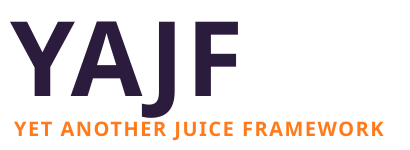

<p align="center">
  
</p>

<p align="center">
  Game-feel effects for Godot 4: tweens, shakes, hit-stops, squash &amp; stretch and more.<br>
  A GDScript API with a native GDExtension core.
</p>

> **Status: early development.** The API is not stable yet. The library is being
> ported from GDScript to C++ one hot path at a time; anything not ported yet
> still runs in GDScript.

## How it's built

YAJF is a hybrid. The public API (`Yajf`) and the authoring/editor tools live in
GDScript; the parts that need to be fast move into the native library
(`yajf.gdextension`) only when a benchmark shows they need to. A native class is
added as the base of the GDScript class it replaces, so the API never changes
while code moves across.

`Yajf.has_native()` tells you whether the native library loaded on the current
platform.

## Requirements

- Godot **4.5 or newer** (developed on 4.7.2-stable)
- Python 3 and [SCons](https://scons.org/) (`brew install scons`)
- A C++17 compiler (Xcode Command Line Tools on macOS)
- For web builds: [Emscripten](https://emscripten.org/) **4.0.11** via emsdk

## Getting started

```sh
git clone --recurse-submodules https://github.com/PomboDev/godot-yajf.git
cd godot-yajf
scons platform=macos            # or linux / windows
```

The built library is copied into `project/addons/yajf/bin/<platform>/`. Open the
`project/` folder in Godot to try it.

### Editor support (clangd, Zed, VS Code)

```sh
scons platform=macos compiledb=yes
```

This writes `compile_commands.json` to the repo root so clangd can find the
generated `godot_cpp` headers. Restart the language server afterwards.

### Web

The web build must use the same Emscripten version as Godot's web export
templates (4.0.11 for Godot 4.7.2).

```sh
source ~/emsdk/emsdk_env.sh
scons platform=web threads=no target=template_debug
scons platform=web threads=no target=template_release
```

In the web export preset, enable **Extensions Support** and leave
**Thread Support** off.

## Repository layout

| Path | What's there |
| --- | --- |
| `src/` | C++ source of the native library |
| `project/` | Godot test project |
| `project/addons/yajf/` | The addon: GDScript API, `yajf.gdextension` and built binaries |
| `doc_classes/` | Class reference XML for native classes |
| `godot-cpp/` | [godot-cpp](https://github.com/godotengine/godot-cpp) submodule (4.5 branch) |
| `docs/` | Logo and documentation |

## CI

- **Continuous Integration** (`ci.yml`) builds a few platform combinations, web
  included, on every push and pull request.
- **Make a GDExtension build** (`make_build.yml`) is run by hand from the
  Actions tab. It builds every platform and uploads an `addons/yajf/` artifact
  you can drop into any Godot project.

## License

[MIT](LICENSE.md) © 2026 PomboDev

Built on the [godot-cpp-template](https://github.com/godotengine/godot-cpp-template).
